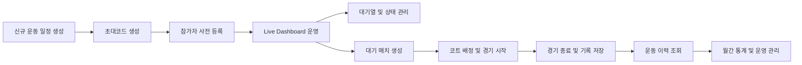
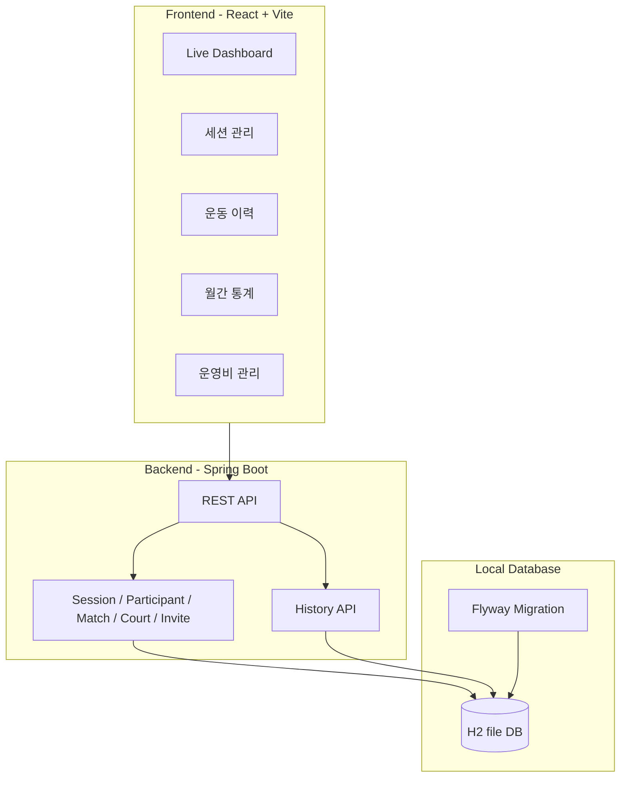

# PlayCock

PlayCock은 배드민턴 모임 운영을 위한 경기 관리 웹 애플리케이션입니다. 관리자는 운동 세션을 만들고, 참가자를 사전 등록하며, Live Dashboard에서 대기열·코트·매치 진행 상태를 관리할 수 있습니다.

현재 프로젝트는 로컬 개발 환경에서 동작하는 단계이며, 추후 AWS Lightsail 등 실제 운영 환경 배포를 고려해 프론트엔드와 백엔드를 분리해 구성했습니다.


## 서비스 흐름



## 시스템 구성



## 주요 기능

### Live Dashboard

- 대기열 관리
- 참가자 상태 변경
  - 대기
  - 매치 준비
  - 경기중
  - 휴식
  - 레슨
  - 미입장
  - 불참
- 대기시간 표시 및 정렬
- 대기 매치 생성
- 코트 배정
- 경기 시작/종료
- 코트 상태 관리
- 매치 라이프사이클 DB 저장

### 세션 관리

- 신규 운동 일정 생성
- 관리 대상 세션 목록 조회
- 세션별 참가자 사전 등록
- 선택 추가 / 전체 추가
- 세션 준비 현황 확인
  - 참가자 수
  - 코트 수
  - 초대코드
- 초대코드 복사
- 초대코드 랜덤 재생성
- 등록 참가자 목록 조회
- 등록 참가자 삭제
  - 경기 배정 또는 경기 이력이 있는 참가자는 삭제 불가

### 운동 이력

- 종료된 세션 기준 운동 이력 조회
- 세션별 참가자 목록 및 상태 표시
- 참가자별 경기 수 및 상세 이력 확인
- 세션별 완료 매치 기록 조회
- 코트별 진행 이력 조회

지각 판정은 세션 예정 시작 시간 기준이 필요하므로 추후 별도 단계에서 다룰 예정입니다.

## 기술 스택

### Frontend

- React
- Vite
- TypeScript
- React Router
- React Query
- SCSS

### Backend

- Java 21
- Spring Boot 3.3
- Spring Web
- Spring Data JPA
- Bean Validation
- Flyway
- H2 Database
- PostgreSQL Driver

### Local Database

- H2 file DB
- 기본 경로: `backend/.local-data/playcock`
- 로컬 DB 파일은 Git에 포함하지 않습니다.

## 프로젝트 구조

```text
PlayCock/
├── backend/
│   ├── src/main/java/com/playcock/
│   │   ├── court/
│   │   ├── finance/
│   │   ├── history/
│   │   ├── invite/
│   │   ├── live/
│   │   ├── match/
│   │   ├── member/
│   │   ├── participant/
│   │   └── session/
│   ├── src/main/resources/
│   │   ├── db/migration/
│   │   ├── db/dev-migration/
│   │   ├── application.yml
│   │   └── application-local.yml
│   ├── build.gradle
│   └── gradlew
├── frontend/
│   ├── src/app/
│   ├── src/components/
│   ├── src/features/
│   │   ├── admin/
│   │   └── live/
│   ├── src/layouts/
│   ├── src/styles/
│   └── package.json
├── docs/
└── README.md
```

## 실행 방법

### 1. 백엔드 실행

```bash
cd backend
./gradlew bootRun --args='--spring.profiles.active=local'
```

기본 실행 주소는 아래와 같습니다.

```text
http://localhost:8080
```

H2 Console은 local profile에서 사용할 수 있습니다.

```text
http://localhost:8080/h2-console
```

기본 JDBC URL은 아래와 같습니다.

```text
jdbc:h2:file:./.local-data/playcock
```

### 2. 프론트엔드 실행

```bash
cd frontend
npm install
npm run dev
```

기본 실행 주소는 아래와 같습니다.

```text
http://localhost:5173
```

관리자 화면은 아래 경로에서 확인할 수 있습니다.

```text
http://localhost:5173/admin/live
http://localhost:5173/admin/sessions
http://localhost:5173/admin/history
http://localhost:5173/admin/analytics
http://localhost:5173/admin/finance
```

## 빌드 및 검증

### Frontend

```bash
cd frontend
npm run build
```

### Backend

```bash
cd backend
./gradlew test
```

## 주요 문서

프로젝트 상세 문서는 `docs/` 아래에 정리되어 있습니다.

- `docs/project-handoff.md`
- `docs/project-todo.md`
- `docs/architecture.md`
- `docs/database.md`
- `docs/api.md`
- `docs/development-guide.md`
- `docs/implementation-plan.md`
- `docs/matching-algorithm.md`

신규 참여자는 아래 순서로 확인하는 것을 권장합니다.

1. `docs/project-handoff.md`
2. `docs/project-todo.md`
3. `docs/architecture.md`
4. `docs/database.md`
5. `docs/api.md`
6. `docs/development-guide.md`

## Git 관리 주의사항

아래 항목은 Git에 포함하지 않습니다.

- `node_modules/`
- `dist/`
- `build/`
- `.gradle/`
- `.env`
- `.DS_Store`
- `backend/.local-data/`
- `INSPINIA_React/`

`backend/.local-data/`에는 로컬 H2 DB 파일이 생성되므로 GitHub에 올리지 않습니다.

## 커밋 메시지 규칙

커밋 메시지는 아래 형식을 사용합니다.

```text
타입: 제목

- 변경 내용 1
- 변경 내용 2
```

예시:

```text
feat: 세션 관리 초대코드 기능 추가

- 초대코드 랜덤 생성 API 추가
- 기존 활성 초대코드 비활성화 처리
- 세션 관리 화면에 복사 및 재생성 버튼 추가
```

주요 타입은 아래와 같습니다.

- `feat`: 기능 추가
- `fix`: 버그 수정
- `docs`: 문서 수정
- `style`: 스타일 수정
- `refactor`: 리팩터링
- `build`: 빌드 설정 수정
- `chore`: 기타 작업

## 남은 작업

### Phase 9. 월간 통계 화면 구현

- 월별 총 세션 수 표시
- 월별 총 참가자 수 표시
- 월별 총 경기 수 표시
- 회원별 참가 횟수 표시
- 회원별 게임 수 표시
- 회원별 상태 통계 표시

### Phase 10. 운영비 관리 화면 구현

- 수입/지출 항목 등록
- 회비 관리
- 대관료 관리
- 벌금 관리
- 회원별 미납 현황 표시
- 월별 정산 요약 표시

### Phase 11. 사용자용 화면 및 초대코드 입장 흐름

- 초대코드 입력 화면 구성
- 초대코드 검증 API 연결
- 사용자용 세션 정보 화면 구성
- 사용자용 참가 신청 흐름 검토
- 모바일 사용성 개선

## 배포 계획

현재는 로컬 H2 DB 기반 개발 단계입니다. 추후 AWS Lightsail 등 운영 환경 배포를 고려합니다.

운영 배포 전 검토할 항목은 아래와 같습니다.

- 운영 DB 전환
  - PostgreSQL 또는 MySQL 검토
- 환경변수 분리
- 운영/로컬 profile 분리 강화
- 인증/권한 구조 설계
- 관리자 로그인 적용 여부 결정
- 사용자 초대코드 접근 보안 검토
- 데이터 백업 정책 수립
- 배포 자동화 검토
