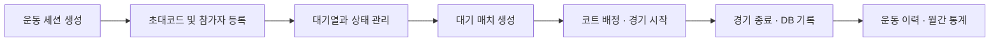
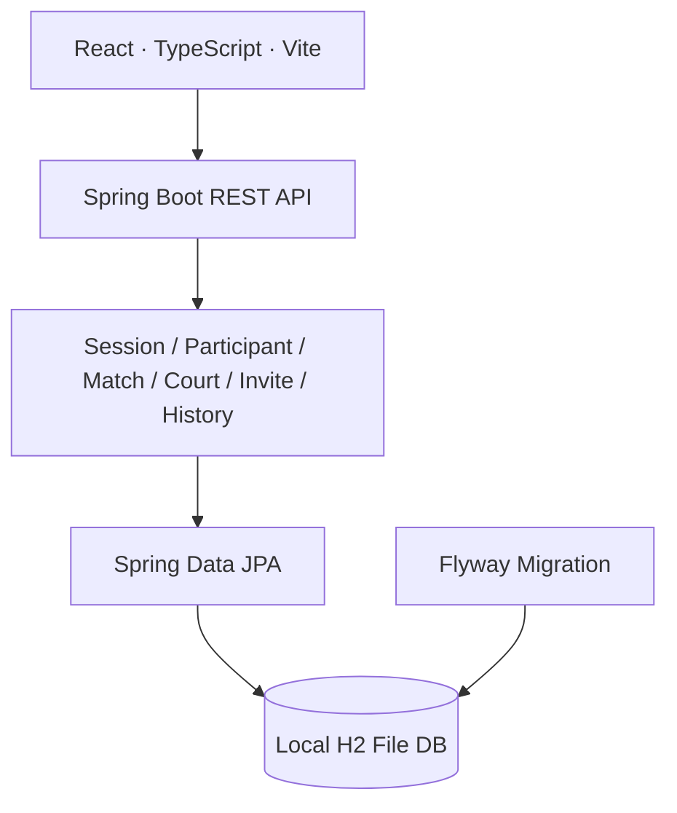

# 🏸 PlayCock
**배드민턴 모임의 경기 운영을 관리하는 웹 애플리케이션**

    

> **개발 상태:** 로컬 개발 단계. 관리자 중심 기능을 구현 중이며, 운영 배포와 사용자용 초대코드 입장 기능은 완료된 서비스로 간주하지 않습니다.

## 1. 문제와 목표

배드민턴 모임에서는 참가자의 출석·휴식 상태, 대기시간, 게임 횟수와 코트 사용 현황을 동시에 확인해야 합니다. 수작업 배정으로 발생하는 누락과 불균형을 줄이기 위해 **세션 생성 → 참가자 등록 → 대기열 → 매치 생성 → 코트 배정 → 경기 종료 및 기록**을 연결한 관리 화면을 만들었습니다.

## 2. 핵심 시나리오



| 영역 | 주요 동작 | 현재 상태 |
| --- | --- | --- |
| Live Dashboard | 대기열·코트·매치 표시, 참가자 상태 변경, 경기 시작/종료 | 관리자 기능 중심 구현 |
| Session | 일정 생성, 참가자 사전 등록, 초대코드 생성·재발급 | 구현 |
| History | 종료 세션·참가자·완료 경기 이력 조회 | 기본 기능 구현 |
| Analytics | 월별 세션, 참가/경기 통계 및 랭킹 | 프로젝트 README 기준 구현 |
| Finance | 운영비 관리 | 확장 진행 중 |
| Viewer | 코드 입력 후 사용자용 조회 화면 | 후속 구현 대상 |

상세 구현 현황은 [작업 현황](docs/project-todo.md)을 확인하세요. 문서에 기록된 완료 표시는 기능 개발 이력이며, 운영 환경에서의 검증 완료를 뜻하지 않습니다.

## 3. 아키텍처와 기술 선택



| 영역 | 기술 | 도입 목적 |
| --- | --- | --- |
| Frontend | React, TypeScript, Vite, React Router, React Query, SCSS | 관리자 화면과 서버 상태 조회 분리 |
| Backend | Java 21, Spring Boot 3.3.7, Spring Web, JPA, Validation | 도메인별 API와 데이터 처리 |
| Storage | 로컬 H2 파일 DB | 개발 중 재기동 후 상태 확인 |
| Schema | Flyway | 스키마 변경 관리 |
| Planned | PostgreSQL 등 운영 DB | 실제 배포 전 전환·검증 예정 |

**핵심 설계 관점**
- **상태 흐름:** 대기·매치 준비·경기 중·휴식·레슨·미입장·불참 등 참가자 상태와 매치 라이프사이클을 연동합니다.
- **기록 보존:** 매치 시작/종료, 참가자 상태 변경, 게임 횟수를 DB에 반영합니다.
- **배정 규칙:** 적은 게임 수, 긴 대기시간, 최근 경기 여부를 고려하는 **규칙 기반 추천 방식**을 문서화했습니다. 추천 알고리즘의 현재 프론트 프로토타입과 향후 백엔드 서비스화는 구분해야 합니다.
- **초대코드:** 세션별 생성·재발급 시 이전 활성 코드를 비활성화하는 흐름을 설계했습니다.

### 상세 설계 문서
[Architecture](docs/architecture.md) · [Database](docs/database.md) · [REST API](docs/api.md) · [Matching Algorithm](docs/matching-algorithm.md) · [Development Guide](docs/development-guide.md)

## 4. 코드 구성

```text
PlayCock/
├── backend/
│   ├── src/main/java/com/playcock/   # session, participant, match, court 등
│   ├── src/main/resources/db/         # Flyway migration
│   └── build.gradle
├── frontend/
│   └── src/                           # app, components, features, layouts
├── docs/                              # API·DB·설계·작업 현황
└── README.md
```

## 5. 로컬 실행

**요구 환경:** Java 21, Node.js/npm

백엔드:
```bash
cd backend
./gradlew bootRun --args='--spring.profiles.active=local'
```
Windows에서는 `gradlew.bat`를 사용할 수 있습니다. 기본 API 주소는 `http://localhost:8080`이며 로컬 H2 Console은 `http://localhost:8080/h2-console`입니다. DB 파일은 `backend/.local-data/`에 저장되며 Git에 포함하지 않습니다.

프론트엔드(별도 터미널):
```bash
cd frontend
npm install
npm run dev
```
개발 서버 기본 주소는 `http://localhost:5173`입니다.

| 관리자 화면 | 경로 |
| --- | --- |
| Live Dashboard | `/admin/live` |
| 세션 관리 | `/admin/sessions` |
| 운동 이력 | `/admin/history` |
| 월간 통계 | `/admin/analytics` |
| 운영비 관리 | `/admin/finance` |

## 6. 검증

```bash
cd backend
./gradlew test

cd ../frontend
npm run build
```

현재 저장소에는 테스트 실행 설정이 있으나, 위 명령이 **충분한 자동화 테스트 커버리지를 보장하지는 않습니다.** 특히 동시 경기 배정, 중복 참여, 상태 전이 실패, 트랜잭션 정합성에 대한 테스트 보강이 다음 과제입니다. 실제 화면 이미지는 검증된 자료 확보 후 추가할 예정입니다.

## 7. 남은 과제

- 사용자용 초대코드 입장 및 모바일 조회 흐름
- 운영비 관리 기능 확장
- 인증·권한 및 초대코드 접근 보안 검토
- 핵심 비즈니스 규칙의 단위·통합 테스트
- 운영 DB, 배포, 백업 및 환경 분리

작업 우선순위와 범위는 [Project To-Do](docs/project-todo.md) 및 [Implementation Plan](docs/implementation-plan.md)을 참고하세요.

---
[개발자 프로필](https://github.com/Leeeyounghwan) · [프로젝트 소스](https://github.com/Leeeyounghwan/PlayCock)
