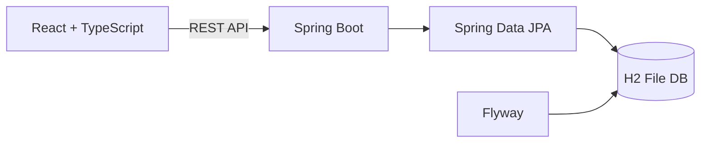

# PlayCock 🏸

배드민턴 모임에서 게임을 운영할 때 쓰려고 만들고 있는 프로그램입니다.

운동할 때마다 누가 몇 게임을 했는지, 누가 오래 기다렸는지, 어느 코트가 비었는지 확인해야 합니다. 인원이 많아지면 이런 걸 머릿속으로 관리하기가 생각보다 어렵습니다. 그래서 참가자 등록부터 경기 배정, 종료 기록까지 한 화면에서 관리할 수 있도록 시작했습니다.

현재는 **관리자 기능을 중심으로 개발 중**이고, 로컬 환경에서 실행할 수 있습니다. 실제 운영 서버에는 아직 배포하지 않았습니다.

## 어떤 기능이 있나요?

- **운동 일정 관리:** 세션을 만들고 참가자를 미리 등록합니다. 세션별 초대코드도 발급하거나 다시 생성할 수 있습니다.
- **Live Dashboard:** 대기 중인 사람, 준비 중인 매치, 사용 중인 코트를 확인합니다. 참가자를 휴식·레슨·미입장 등으로 변경할 수도 있습니다.
- **경기 진행:** 네 명을 매치로 묶고 코트에 배정한 뒤 시작·종료 처리합니다. 진행 상태와 게임 수를 DB에 저장합니다.
- **운동 이력과 통계:** 종료된 세션의 경기 기록을 조회하고, 월별 참가·경기 현황을 확인합니다.
- **운영비 관리:** 화면과 일부 데이터 구조가 있으며, 수입·지출 등 세부 기능을 확장하는 중입니다.

사용자가 초대코드로 들어와 자신의 대기 상태를 확인하는 화면은 앞으로 구현할 예정입니다.

### 실제 운영 흐름


## 만들면서 신경 쓴 부분

### 경기 상태를 어떻게 관리할까?

대기열에 있던 사람이 매치에 들어가면 다른 매치에서 다시 선택되면 안 됩니다. 경기가 끝났을 때는 참가자 상태와 누적 게임 수도 함께 변경돼야 하고요.

그래서 세션, 참가자, 매치, 코트를 별도 도메인으로 나누고 상태 변경을 서버와 DB에 반영하는 형태로 구성했습니다. 동시 요청에서 중복 배정이 생기는 상황은 추가 테스트가 필요합니다.

### 매치는 어떤 기준으로 추천할까?

무조건 랜덤으로 네 명을 뽑으면 누군가는 계속 쉬고 누군가는 연속으로 게임을 하게 됩니다.

우선 게임 수가 적은 사람, 대기시간이 긴 사람을 고려하고 최근에 게임한 사람에게는 불이익을 주는 규칙을 검토했습니다. 팀을 나눌 때는 급수 균형도 고려합니다.

지금 [매칭 알고리즘 문서](docs/matching-algorithm.md)의 내용은 **프론트엔드 프로토타입 기준**입니다. 자동 확정이나 백엔드 추천 서비스가 완성됐다는 의미는 아닙니다.

### DB와 화면은 분리했습니다

프론트엔드는 React, 백엔드는 Spring Boot로 구성했습니다. 로컬에서는 H2 파일 DB를 사용하므로 서버를 재시작해도 개발 데이터를 유지할 수 있습니다. 테이블 구조 변경에는 Flyway를 사용합니다.



## 사용 기술

| 구분 | 기술 |
| --- | --- |
| Frontend | React, TypeScript, Vite, React Router, React Query, SCSS |
| Backend | Java 21, Spring Boot 3.3.7, Spring Data JPA, Validation |
| Database | H2 (로컬), Flyway |
| Build | Gradle, npm |

## 로컬에서 실행하기

Java 21과 Node.js/npm이 필요합니다.

**1. 백엔드 실행**

```bash
cd backend
./gradlew bootRun --args='--spring.profiles.active=local'
```

Windows에서는 `gradlew.bat`를 사용하면 됩니다. 기본 주소는 `http://localhost:8080`, 로컬 H2 Console은 `http://localhost:8080/h2-console`입니다.

**2. 프론트엔드 실행 (다른 터미널)**

```bash
cd frontend
npm install
npm run dev
```

기본 주소는 `http://localhost:5173`입니다.

관리자 페이지는 `/admin/live`, `/admin/sessions`, `/admin/history`, `/admin/analytics`, `/admin/finance`에서 확인할 수 있습니다.

**3. 빌드 및 테스트**

```bash
# backend 디렉터리
./gradlew test

# frontend 디렉터리
npm run build
```

테스트 실행 설정은 있지만, 경기 중복 배정·동시 처리 등의 주요 규칙에 대한 자동화 테스트는 더 보강하려고 합니다.

## 관련 문서

- [전체 구조](docs/architecture.md) / [DB](docs/database.md) / [API](docs/api.md)
- [매칭 방식](docs/matching-algorithm.md)
- [작업 현황과 남은 할 일](docs/project-todo.md)
- [개발 가이드](docs/development-guide.md)

## 앞으로 할 일

사용자용 화면, 운영비 관리, 로그인과 권한 처리, 운영 DB 전환, 핵심 로직의 테스트를 차례로 진행할 계획입니다. 운영 배포 전에는 보안과 백업 정책도 정해야 합니다.

---

[GitHub 프로필](https://github.com/Leeeyounghwan)
